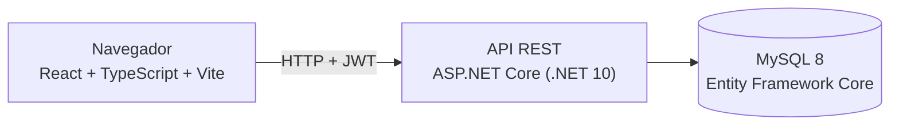

# ChordStore
 
**Loja virtual de instrumentos musicais com site público, carrinho e checkout, e uma área administrativa completa (produtos, categorias, fornecedores, clientes e vendas).**
 
> Trabalho de faculdade, desenvolvido em grupo.
 
## Equipe
 
| Integrante | Responsabilidade |
|---|---|
| **Sérgio** | Backend e estrutura do projeto (servidor, banco de dados e configuração) |
| **Ana Rita** | Design da interface no Figma |
| **Wesley** | Backend |
 
## O que o projeto faz
 
| Área | Recursos |
|---|---|
| **Site público** (`/`) | Página inicial com destaques, lançamentos e seção sobre a loja. Modal de produto, carrinho, localização, promoções e login. Botão de WhatsApp. Página de planos (`/planos`). |
| **Checkout** | O carrinho coleta os dados do cliente e a forma de pagamento (com parcelas), registra a venda e dá baixa no estoque. |
| **Painel administrativo** (`/admin`) | Login, dashboard com indicadores e CRUD de produtos, categorias, fornecedores e clientes. Vendas em formato de PDV (lançar, listar e mudar o status). Tela "Minha Conta" para trocar usuário, e-mail e senha. |
 
## Arquitetura
 

 
- As rotas `/api/admin/*` exigem token **JWT**. O catálogo (`/api/instruments`) e o checkout (`/api/checkout`) são públicos.
- O login do administrador é validado contra a tabela `AdminUsers`. As senhas ficam como hash **PBKDF2** (SHA-256, 100 000 iterações e sal aleatório).
- Ao cancelar uma venda pelo painel, o estoque dos produtos é devolvido. Produtos com preço "sob consulta" não podem ser vendidos até terem um preço definido.
## Stack
 
| Camada | Tecnologias |
|---|---|
| Frontend | React 18, TypeScript, Vite, React Router |
| Backend | C#, .NET 10, ASP.NET Core Web API, Entity Framework Core 9, Swagger |
| Banco de dados | MySQL 8 (Pomelo) |
| Autenticação | JWT (JwtBearer) |
 
## Como rodar
 
**Pré-requisitos:** SDK .NET 10, Node.js, MySQL 8 rodando em `localhost:3306` e a ferramenta `dotnet-ef`.
 
**1. Backend** (`InstrumentsStore.Api`)
 
Confira a connection string em `appsettings.json` (banco `InstrumentsStoreDb`). Depois:
 
```bash
cd InstrumentsStore.Api
dotnet restore
dotnet ef database update
dotnet run
```
 
O `database update` cria as tabelas e carrega os instrumentos iniciais. A documentação interativa (Swagger) abre em ambiente de desenvolvimento.
 
**2. Frontend** (`chordstore-web`)
 
```bash
cd chordstore-web
npm install
cp .env.example .env     # no Windows: copy .env.example .env
npm run dev
```
 
No `.env`, aponte `VITE_API_PROXY` para o endereço da API, que está em `InstrumentsStore.Api/Properties/launchSettings.json` (por padrão `http://localhost:5079` ou `https://localhost:7156`). O site abre em `http://localhost:5173`, e o painel em `/admin/login`.
 
O login inicial do administrador está descrito em [README_ADMIN.md](README_ADMIN.md). Troque a senha em **Minha Conta** assim que entrar.
 
## Estrutura
 
```
├── InstrumentsStore.Api/     API REST (Controllers, Models, Dtos, Services, Security, Migrations)
├── chordstore-web/           Site e painel administrativo (React + TypeScript)
│   └── src/                  pages, components, admin, api, context, hooks
├── README_ADMIN.md           Detalhes do módulo administrativo e do checkout
└── LojaInstrumentos.slnx     Solução .NET
```
 
## Limitações
 
| Limitação | Detalhe |
|---|---|
| **Credenciais de desenvolvimento** | A senha do MySQL, a chave do JWT e o login inicial do administrador são de desenvolvimento. Em uso real, use variáveis de ambiente ou *user-secrets* e gere uma chave nova. |
| **CORS local** | A API só aceita requisições de `http://localhost:5173`. |
| **Sem testes automatizados** | A verificação foi manual. |
 
## Próximos passos
 
| Melhoria | Por quê |
|---|---|
| Colocar API, painel e banco em contêineres com `docker-compose` | Subir tudo com um comando. |
| Testes automatizados do checkout e do login | Proteger a baixa de estoque e a autenticação contra regressões. |
| Mover os segredos para variáveis de ambiente | Tirar a chave JWT e a senha do banco do repositório. |
 
